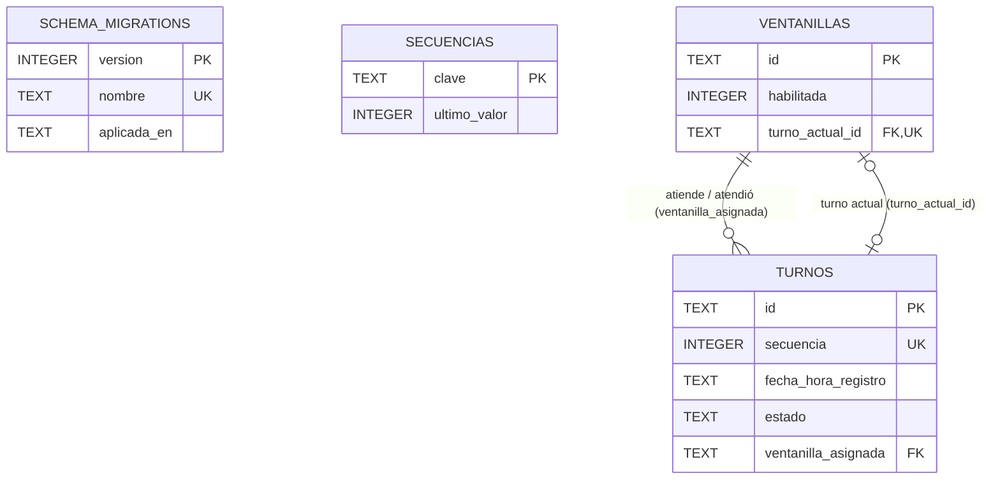

# Esquema de Base de Datos SQLite (SGT)

> **Issue relacionado:** `#18` (*Definir el esquema de la base de datos en SQLite*) · **Sub-issue del backlog:** `#05-A`
> **Migración inicial:** [`src-tauri/migrations/001_initial.sql`](../src-tauri/migrations/001_initial.sql)
> **Módulo de inicialización y pruebas:** [`src-tauri/src/db.rs`](../src-tauri/src/db.rs)

---

## 1. Decisiones de Diseño

1. **Motor embebido sin servidor externo (`RD-01`, `RC-04`, `RNF-S03`):**
   * Se utiliza **SQLite 3** embebido en el backend Rust mediante `rusqlite` con la característica `bundled`, evitando instalaciones externas en Windows, macOS y Linux.
   * El frontend nunca ejecuta SQL directo (`RNF-S01`, `RNF-M01`).
2. **PRAGMAs obligatorios por conexión:**
   * `PRAGMA foreign_keys = ON;` — activa el cumplimiento de llaves foráneas en cada conexión.
   * `PRAGMA journal_mode = WAL;` — mejora concurrencia y seguridad ante interrupciones (`RD-02`).
   * `PRAGMA synchronous = NORMAL;` y `PRAGMA busy_timeout = 5000;` — equilibrio entre durabilidad y prevención de bloqueos transitorios.
3. **Extensibilidad de ventanillas (separación catálogo ↔ turnos):**
   * Para cumplir `RN-03` y `RC-03`, la migración `001_initial.sql` inserta únicamente las 3 ventanillas predefinidas (`V01`, `V02`, `V03`).
   * **Sin embargo, ni `ventanillas` ni `turnos` hardcodean `IN ('V01', 'V02', 'V03')` en su definición DDL:**
     * `ventanillas.id` valida el formato (`V` seguido de dígitos, p. ej. `V01`, `V02`, `V03`, `V04`).
     * `turnos.ventanilla_asignada` delega la validez exclusivamente a `FOREIGN KEY REFERENCES ventanillas(id)`.
   * **Resultado:** hoy intentar usar `'V04'` falla por llave foránea (`CV-03`), pero si en el futuro se requiere una cuarta ventanilla basta una migración `002_agregar_v04.sql` con un único `INSERT INTO ventanillas`, sin alterar ni reconstruir tablas.

---

## 2. Diagrama Entidad-Relación



---

## 3. Diccionario de Tablas y Restricciones

### 3.1 `schema_migrations`
Controla qué migraciones SQL ya se aplicaron sobre la base de datos local.

| Columna | Tipo SQLite | Restricciones | Descripción |
| :--- | :--- | :--- | :--- |
| `version` | `INTEGER` | `PRIMARY KEY`, `CHECK (version > 0)` | Número secuencial de migración (`1`, `2`, ...). |
| `nombre` | `TEXT` | `NOT NULL`, `UNIQUE`, no vacío | Identificador de la migración (ej. `'001_initial'`). |
| `aplicada_en` | `TEXT` | `NOT NULL`, default ISO-8601 UTC | Fecha y hora en que se aplicó. |

### 3.2 `secuencias`
Conserva los contadores monotónicos entre reinicios (`RN-02`, `CV-08`).

| Columna | Tipo SQLite | Restricciones | Descripción |
| :--- | :--- | :--- | :--- |
| `clave` | `TEXT` | `PRIMARY KEY`, no vacío | Nombre del contador (semilla inicial: `'turno'`). |
| `ultimo_valor` | `INTEGER` | `NOT NULL`, `DEFAULT 0`, `CHECK (ultimo_valor >= 0)` | Última secuencia asignada; se incrementa en la misma transacción del `INSERT` de turno. |

### 3.3 `ventanillas`
Catálogo de ventanillas lógicas (`RN-03`, `RC-03`, `RN-04`, `RN-05`, `RF-13`).

| Columna | Tipo SQLite | Restricciones | Descripción |
| :--- | :--- | :--- | :--- |
| `id` | `TEXT` | `PRIMARY KEY`, formato `V<dígitos>` (`length >= 3`) | Identificador de ventanilla (`V01`, `V02`, `V03`). |
| `habilitada` | `INTEGER` | `NOT NULL`, `DEFAULT 1`, `CHECK (habilitada IN (0, 1))` | `1` activa, `0` inhabilitada (`RF-13`). |
| `turno_actual_id` | `TEXT` | `NULL`, `UNIQUE`, `FK -> turnos(id) ON DELETE RESTRICT` | Turno actualmente `EN_ATENCION` en esta ventanilla, o `NULL` si está libre. |

* **Restricción de tabla:** `CHECK (habilitada = 1 OR turno_actual_id IS NULL)` — impide inhabilitar una ventanilla ocupada (`RF-13`).
* **Semilla inicial:** `('V01', 1, NULL)`, `('V02', 1, NULL)`, `('V03', 1, NULL)`.

### 3.4 `turnos`
Cola única FIFO e historial permanente de todos los turnos (`RF-02`, `RF-03`, `RF-10`, `RN-01`–`RN-09`).

| Columna | Tipo SQLite | Restricciones | Descripción |
| :--- | :--- | :--- | :--- |
| `id` | `TEXT` | `PRIMARY KEY`, no vacío | Identificador único del turno (ej. `'T-0001'`). |
| `secuencia` | `INTEGER` | `NOT NULL`, `UNIQUE`, `CHECK (secuencia > 0)` | Orden monotónico creciente que define la disciplina FIFO (`RN-02`). |
| `fecha_hora_registro` | `TEXT` | `NOT NULL`, no vacío | Marca de tiempo ISO-8601 de creación (`RF-02`). |
| `estado` | `TEXT` | `NOT NULL`, `CHECK (estado IN ('EN_ESPERA', 'EN_ATENCION', 'ATENDIDO', 'CANCELADO'))` | Estado actual del ciclo de vida (emula `ENUM` en SQLite). |
| `ventanilla_asignada` | `TEXT` | `NULL`, `FK -> ventanillas(id) ON DELETE RESTRICT` | Ventanilla asociada (`NULL` antes de asignar o si fue cancelado). |

* **Restricción de tabla (coherencia estado ↔ ventanilla):**
  * `EN_ESPERA` y `CANCELADO` exigen `ventanilla_asignada IS NULL` (`RN-07`).
  * `EN_ATENCION` y `ATENDIDO` exigen `ventanilla_asignada IS NOT NULL` (`RF-04`, `RF-06`, `RF-10`).

---

## 4. Índices y Triggers de Integridad

### Índices
| Índice | Tabla / Columnas | Propósito |
| :--- | :--- | :--- |
| `ux_turnos_un_activo_por_ventanilla` | `UNIQUE ON turnos(ventanilla_asignada) WHERE estado = 'EN_ATENCION'` | Blinda `RN-04`: máximo 1 turno en atención por ventanilla (escala a N ventanillas). |
| `ix_turnos_cola_fifo` | `ON turnos(secuencia ASC) WHERE estado = 'EN_ESPERA'` | Acelera consulta de cola FIFO y selección del siguiente turno (`RF-03`, `RF-04`, `RNF-P01`). |
| `ix_turnos_estado_secuencia` | `ON turnos(estado, secuencia ASC)` | Acelera consultas de historial (`RF-10`, `RNF-P01`). |

### Triggers
| Trigger | Evento | Regla protegida |
| :--- | :--- | :--- |
| `trg_ventanillas_minimo_una_activa` | `BEFORE UPDATE OF habilitada ON ventanillas` | `RF-13`: impide dejar 0 ventanillas activas (`ULTIMA_VENTANILLA_ACTIVA`). |
| `trg_ventanillas_no_delete` | `BEFORE DELETE ON ventanillas` | `RC-03` / `RN-03`: impide borrar ventanillas del catálogo. |
| `trg_turnos_no_delete` | `BEFORE DELETE ON turnos` | `RN-09`: impide eliminar turnos del historial. |
| `trg_turnos_estados_terminales` | `BEFORE UPDATE ON turnos` | `RN-07` / `RN-09`: bloquea cambios sobre turnos `ATENDIDO` o `CANCELADO`. |

---

## 5. Cómo Inicializar y Probar la Base de Datos

### Desde Rust (forma usada por la aplicación y pruebas)
```rust
use gestor_de_turnos_lib::db::{abrir_conexion, abrir_en_memoria};

// Inicialización en archivo local (crea carpetas padre si no existen):
let conn = abrir_conexion("ruta/a/sgt.db")?;

// Inicialización en memoria (tests unitarios):
let mem = abrir_en_memoria()?;
```

### Desde la línea de comandos con `sqlite3` (opcional para inspección)
```sh
sqlite3 sgt.db < src-tauri/migrations/001_initial.sql
```

### Ejecutar las pruebas automatizadas del esquema
```sh
cd src-tauri
cargo test db::tests
```
